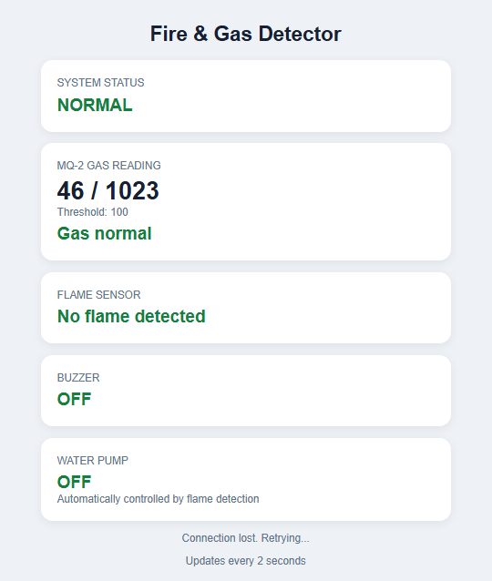

# 🔥 ESP-12E Fire and Gas Detector

An IoT-based fire and gas detection system using the **ESP8266 NodeMCU ESP-12E**, MQ-2 gas sensor, flame sensor, buzzer, relay module, and water pump. This project detects gas or smoke and flame conditions, activates an alarm, and controls a water pump through a relay when a flame is detected.

## 📌 Project Overview

Fire and gas leaks can cause serious damage if not detected quickly. This project demonstrates a low-cost embedded monitoring system using sensors and an ESP8266 microcontroller.

The system reads sensor values, triggers alerts based on programmed conditions, and provides a local web dashboard for monitoring.

## ✨ Features

- 🔥 Flame detection using a flame sensor
- 💨 Gas and smoke detection using an MQ-2 sensor
- 🔊 Buzzer alarm for detected hazards
- 💧 Automatic water pump control through a relay when a flame is detected
- 📶 Wi-Fi connectivity using ESP8266
- 🌐 Local web dashboard for sensor monitoring
- 📱 Dashboard accessible through a browser on the same Wi-Fi network
- 🛠️ Beginner-friendly IoT and embedded systems project

## 🖼️ Wiring Diagram

The following diagram illustrates the intended hardware connections for the project.


## 📊 Web Dashboard

The dashboard provides a browser-based interface for viewing sensor monitoring information.



## 🧰 Hardware Requirements

- ESP8266 NodeMCU ESP-12E development board
- MQ-2 gas sensor module
- Flame sensor module
- 3-pin buzzer module
- Relay module compatible with the controller and load
- 5V DC water pump
- Suitable power supply for the water pump
- USB cable for programming
- Jumper wires
- Computer with Arduino IDE

## 🔌 Pin Connections

| Component | NodeMCU Pin |
|---|---|
| MQ-2 gas sensor analog output (AO) | A0 |
| Flame sensor digital output (DO) | D5 |
| Buzzer signal | D6 |
| Relay module input (IN) | D1 |
| Ground connections | GND, as required by the modules |

**Important:** Verify the actual pin labels on your modules before connecting them. The MQ-2 analog output must remain within your specific NodeMCU board's A0 input voltage limit.

## 💻 Software Requirements

- Arduino IDE
- ESP8266 board package for Arduino IDE
- `ESP8266WiFi` library
- `ESP8266WebServer` library

The ESP8266 libraries are included with the ESP8266 Arduino core.

## ⚙️ How It Works

1. The MQ-2 sensor detects changes in gas and smoke levels.
2. The flame sensor detects a flame according to its configured output.
3. The ESP8266 reads the sensor signals.
4. The buzzer activates when the programmed gas or flame conditions are met.
5. The relay controls the water pump when the program detects a flame.
6. The ESP8266 hosts a local web dashboard that displays monitoring information.

## 🚀 Installation and Setup

### Step 1: Install Arduino IDE

Download and install the Arduino IDE from the official website:

https://www.arduino.cc/en/software

### Step 2: Install the ESP8266 Board Package

Add the ESP8266 board support through Arduino IDE's Boards Manager, then select the appropriate NodeMCU ESP8266 board.

### Step 3: Download This Repository

Clone or download this GitHub repository:

https://github.com/IamAnandMahato/ESP12E-Fire-Gas-Detector

### Step 4: Configure Wi-Fi

Open `fire_gas_detector.ino` and enter your Wi-Fi credentials in the appropriate variables:

```cpp
const char* WIFI_SSID = "YOUR_WIFI_NAME";
const char* WIFI_PASSWORD = "YOUR_WIFI_PASSWORD";
```

Replace the placeholders with your actual network details. Never publish your real Wi-Fi password or API keys in a public repository.

### Step 5: Upload the Code

1. Connect the NodeMCU to your computer using a USB cable.
2. Select the correct ESP8266 board in Arduino IDE.
3. Select the correct COM port.
4. Upload the program.

### Step 6: Open the Dashboard

1. Open Serial Monitor at **115200 baud**.
2. Wait for the board to connect to Wi-Fi.
3. Find the IP address printed in Serial Monitor.
4. Connect your phone to the same Wi-Fi network.
5. Enter the IP address into your phone's browser.

The dashboard is designed for local-network access. Remote monitoring over the internet is not included by default.

## 🧪 Testing

Test each component separately before operating the complete system.

- **Gas sensor:** Check readings and calibrate the gas threshold.
- **Flame sensor:** Verify its output under controlled conditions.
- **Buzzer:** Confirm the buzzer responds to the programmed alarm conditions.
- **Relay:** Test relay operation with the pump disconnected first.
- **Dashboard:** Confirm that the browser displays sensor information.
- **Pump:** Connect it only after confirming the relay's startup state and wiring.

## ⚠️ Safety Precautions

- Do not power the pump directly from a NodeMCU GPIO pin.
- Use a separate, correctly rated supply for the pump.
- Check the relay's contact rating against the pump's startup current.
- Verify relay polarity and ensure the pump remains OFF during startup.
- Confirm that the relay input works with the controller's logic voltage.
- MQ-2 sensors require warm-up and calibration; thresholds depend on the sensor and environment.
- Check the MQ-2 output voltage before connecting it to A0.
- This project is an educational prototype, not a certified fire alarm or fire suppression system.
- **Never use water on electrical, oil, or chemical fires.** Do not rely on this project for real-world fire protection.

## 🔮 Future Improvements

- Cloud-based monitoring
- Mobile notifications for hazardous conditions
- Sensor data logging and historical graphs
- Improved gas sensor calibration
- AI-assisted hazard analysis
- Remote monitoring with appropriate security

## 📁 Project Structure

```text
ESP12E-Fire-Gas-Detector/
├── fire_gas_detector.ino
├── ESP-12E Fire and Gas Detector Wiring Guide.png
├── screenshot.png
└── README.md
```

## 👨‍💻 Author

**Anand Mahato**

GitHub: https://github.com/IamAnandMahato

## 📄 License

This project is intended for educational and learning purposes. No specific open-source license is currently declared. Add a `LICENSE` file if you want to define how others may use, modify, and distribute your code.
